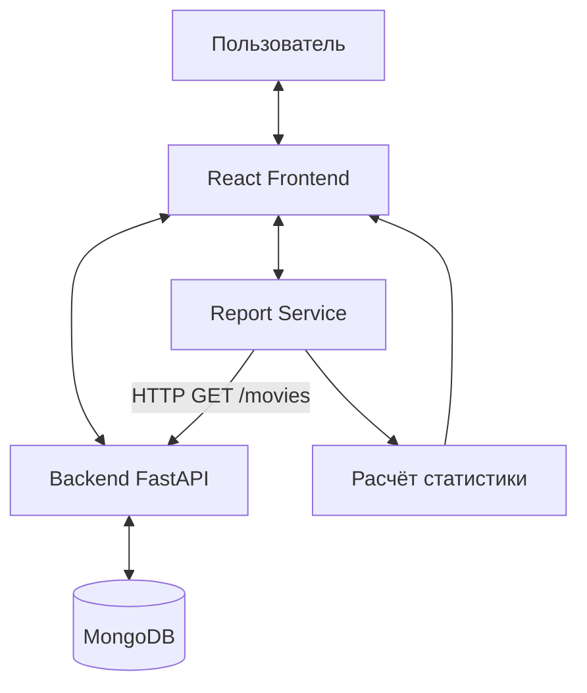

# Личный каталог фильмов

Веб-приложение для ведения персональной коллекции фильмов, отслеживания просмотренных кинолент и формирования статистических отчётов.

Проект разработан в рамках курсовой работы по дисциплине «Технологии сетевого взаимодействия».

## О проекте

**Личный каталог фильмов** — это веб-приложение, позволяющее пользователю создавать собственную коллекцию фильмов, управлять информацией о них и отслеживать прогресс просмотра.

Приложение построено на основе микросервисной архитектуры. Основной Backend отвечает за операции с фильмами и взаимодействие с базой данных, а отдельный микросервис Report Service получает информацию от основного сервиса и формирует статистические отчёты.

## Основные возможности

- Добавление новых фильмов в каталог.
- Просмотр списка сохранённых фильмов.
- Изменение статуса просмотра фильма.
- Выставление и изменение пользовательской оценки.
- Удаление фильмов.
- Поиск фильмов по названию.
- Фильтрация по жанрам и статусу просмотра.
- Сортировка списка фильмов.
- Сохранение данных в MongoDB.
- Автоматическое обновление статистики.
- Формирование отчёта по всей коллекции фильмов.

## Используемые технологии

| Компонент | Технология |
|---|---|
| Frontend | React |
| Сборка Frontend | Vite |
| Backend | Python, FastAPI |
| Report Service | Python, FastAPI |
| База данных | MongoDB 8.0 |
| HTTP-взаимодействие | HTTP, httpx |
| Контейнеризация | Docker |
| Оркестрация контейнеров | Docker Compose |
| Документация API | Swagger / OpenAPI |

## Архитектура приложения

Приложение состоит из трёх основных компонентов:

1. **Frontend** — пользовательский интерфейс на React. Обеспечивает взаимодействие пользователя с каталогом фильмов.
2. **Backend** — основной сервер на FastAPI. Обрабатывает запросы пользователя, выполняет CRUD-операции и взаимодействует с MongoDB.
3. **Report Service** — отдельный микросервис на FastAPI. Получает список фильмов от основного Backend посредством HTTP-запроса и рассчитывает статистику.

### Схема взаимодействия



## Структура проекта

```text
movie-catalog/
│
├── backend/
│   ├── app/
│   │   ├── __init__.py
│   │   ├── database.py
│   │   ├── main.py
│   │   └── schemas.py
│   ├── Dockerfile
│   └── requirements.txt
│
├── frontend/
│   ├── src/
│   ├── public/
│   ├── package.json
│   └── ...
│
├── report-service/
│   ├── app/
│   │   ├── __init__.py
│   │   └── main.py
│   ├── Dockerfile
│   └── requirements.txt
│
├── .gitignore
├── docker-compose.yml
└── README.md
```

## Запуск проекта

### Требования

Перед запуском необходимо установить:

- Docker Desktop;
- Node.js и npm;
- Git (для работы с репозиторием).

### 1. Клонирование репозитория

```bash
git clone https://github.com/venflaxine/TechnologiiSetevogoVzaikmodeystvya.git
```

Перейти в папку проекта:

```bash
cd TechnologiiSetevogoVzaikmodeystvya
```

### 2. Запуск Backend, Report Service и MongoDB

В корневой папке проекта выполнить:

```bash
docker compose up -d --build
```

Docker Compose автоматически соберёт и запустит контейнеры:

- основной Backend;
- Report Service;
- MongoDB.

Для проверки состояния контейнеров:

```bash
docker compose ps
```

### 3. Запуск Frontend

Открыть отдельное окно терминала и перейти в папку frontend:

```bash
cd frontend
```

Установить зависимости:

```bash
npm install
```

Запустить приложение:

```bash
npm run dev
```

После запуска приложение будет доступно по адресу:

http://localhost:5173/

## API и документация

Для просмотра и тестирования API используются автоматически сформированные страницы Swagger.

| Сервис | Адрес |
|---|---|
| Основной Backend Swagger | http://localhost:8000/docs |
| Report Service Swagger | http://localhost:8001/docs |

### Основной Backend

| Метод | Endpoint | Назначение |
|---|---|---|
| GET | `/movies` | Получение списка фильмов |
| POST | `/movies` | Добавление фильма |
| PATCH | `/movies/{id}/status` | Изменение статуса и оценки |
| DELETE | `/movies/{id}` | Удаление фильма |

### Report Service

| Метод | Endpoint | Назначение |
|---|---|---|
| GET | `/` | Информация о сервисе |
| GET | `/health` | Проверка работоспособности |
| GET | `/reports/summary` | Получение статистического отчёта |

### Формируемая статистика

Report Service рассчитывает:

- общее количество фильмов;
- количество просмотренных фильмов;
- количество запланированных фильмов;
- среднюю оценку просмотренных фильмов, имеющих оценку